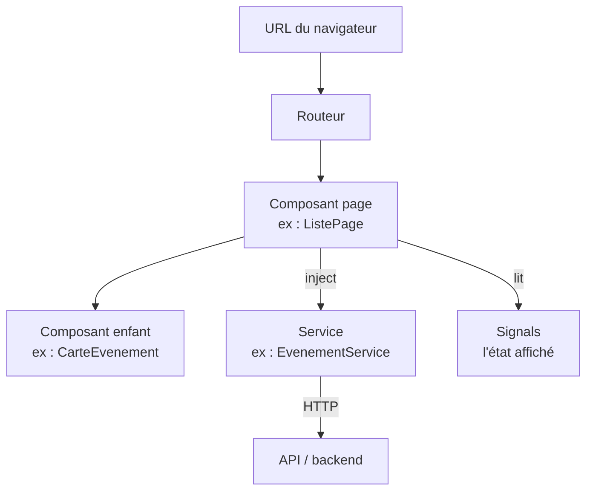
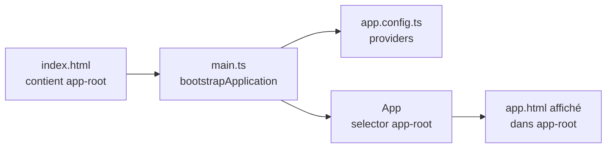
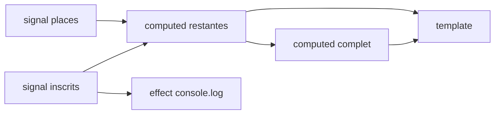
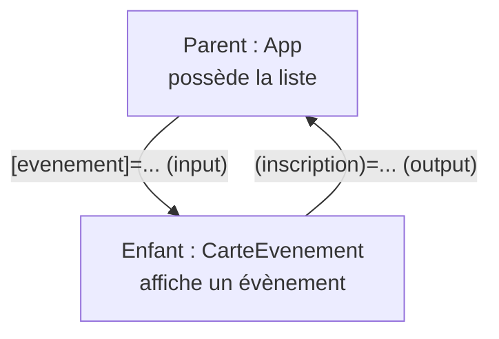

# Cours Angular 22 — de zéro à autonome

Sep 23, 2026 · @Someone

## 0. Mode d'emploi

Ce cours part de zéro et suit un seul fil : construire une petite appli de **liste d'évènements**, un peu plus riche à chaque chapitre. Il utilise la syntaxe moderne d'Angular 22 (sortie le 3 juin 2026). Si le cours de ton prof utilise une syntaxe plus ancienne, le chapitre 10 sert de traducteur.

**Comment l'utiliser :**

1. Lis le chapitre, tape les exemples toi-même (pas de copier-coller : c'est en tapant qu'on retient).
2. Fais l'exercice en fin de chapitre, sans regarder ailleurs.
3. Envoie-moi ton code dans le chat : je te fais un retour, puis on passe au suivant.

**Prérequis :** HTML, CSS, et les bases de JavaScript/TypeScript (variables, fonctions, classes, tableaux). Si TypeScript te bloque, dis-le-moi, on fera un détour.

### La carte mentale d'Angular

Une appli Angular, c'est un arbre de **composants** (des morceaux d'écran). Les composants affichent des données stockées dans des **signals**, et vont chercher ce qui est partagé dans des **services**. Le **routeur** choisit quel composant afficher selon l'URL.



Retiens juste ceci pour l'instant : **composant = ce qu'on voit**, **signal = une donnée qui change**, **service = ce qu'on partage**, **routeur = quelle page**. Tout le reste du cours détaille ces quatre idées.

## 1. Installer et créer un projet

Trois commandes suffisent pour avoir une appli qui tourne. Il te faut **Node.js en version LTS récente** (vérifie avec `node -v`).

```bash
npm install -g @angular/cli   # installe la commande "ng" (une seule fois)
ng new hub-evenements         # crée le projet (réponds : CSS, pas de SSR pour commencer)
cd hub-evenements
ng serve                      # lance le serveur de dev sur http://localhost:4200
```

Laisse `ng serve` tourner : chaque fois que tu sauvegardes un fichier, la page se recharge toute seule.

### Les fichiers qui comptent

Un projet neuf contient beaucoup de fichiers. Au début, seuls ceux-ci t'intéressent :

| Fichier | Rôle |
| --- | --- |
| `src/index.html` | La seule vraie page HTML. Elle contient la balise `<app-root>` où Angular s'affiche. |
| `src/main.ts` | Le point de départ : démarre l'appli avec le composant `App`. |
| `src/app/app.ts` | Le composant racine (la logique, en TypeScript). |
| `src/app/app.html` | Son template (ce qui s'affiche). |
| `src/app/app.css` | Son style, qui ne s'applique qu'à lui. |
| `src/app/app.config.ts` | La configuration globale (routeur, HTTP…). |
| `src/app/app.routes.ts` | La liste des pages et de leurs URL. |

Depuis Angular 20, les fichiers n'ont plus de suffixe : on écrit `app.ts` et plus `app.component.ts`. Si ton prof ou un tuto montre `.component.ts`, c'est juste l'ancienne convention.

### Le cycle de démarrage



Le navigateur charge `index.html`, `main.ts` démarre Angular, qui repère `<app-root>` et y affiche le template du composant `App`.

### Commandes utiles au quotidien

| Commande | Ce qu'elle fait |
| --- | --- |
| `ng serve` | Lance le serveur de dev |
| `ng generate component nom` (ou `ng g c nom`) | Crée un composant (4 fichiers) |
| `ng g s nom` | Crée un service |
| `ng build` | Construit la version de production dans `dist/` |
| `ng test` | Lance les tests |

### Exercice 1

1. Crée le projet `hub-evenements` et lance-le.
2. Ouvre `app.html`, efface tout son contenu et remplace-le par un `<h1>Hub évènements</h1>`.
3. Dans `app.css`, colore ce titre.
4. Question : pourquoi ta couleur ne s'applique-t-elle pas à un `<h1>` que tu mettrais directement dans `index.html` ? (indice : relis la ligne sur `app.css` dans le tableau)

## 2. Les composants

Un composant = **une classe TypeScript + un template HTML + du CSS**, réunis sous un nom de balise. C'est la brique de base : toute l'appli est un emboîtement de composants.

Analogie Airbus : un composant, c'est un sous-ensemble (un pylône, une nacelle). Il a sa propre définition, on peut l'installer à plusieurs endroits, et l'avion complet est un assemblage de sous-ensembles.

### Anatomie

`ng g c carte-evenement` génère ceci :

```typescript
// carte-evenement.ts
import { Component } from '@angular/core';

@Component({
  selector: 'app-carte-evenement',     // le nom de la balise à utiliser en HTML
  imports: [],                         // les autres composants utilisés dans le template
  templateUrl: './carte-evenement.html',
  styleUrl: './carte-evenement.css',
})
export class CarteEvenement {
  titre = 'Concert de rentrée';        // une propriété, lisible par le template
}
```

```html
<!-- carte-evenement.html -->
<article>
  <h2>{{ titre }}</h2>
</article>
```

Les trois morceaux à comprendre :

- `@Component({...})` est un **décorateur** : il dit à Angular « cette classe est un composant, voici sa configuration ».
- `selector` : le nom de la balise. Ici, on écrira `<app-carte-evenement />` ailleurs.
- La **classe** contient les données et les méthodes ; le **template** les affiche. `{{ titre }}` lit la propriété `titre` de la classe.

### Utiliser un composant dans un autre

Pour afficher `CarteEvenement` dans `App`, il faut deux choses : l'importer dans `imports`, et écrire sa balise.

```typescript
// app.ts
import { Component } from '@angular/core';
import { CarteEvenement } from './carte-evenement/carte-evenement';

@Component({
  selector: 'app-root',
  imports: [CarteEvenement],   // oublier cette ligne = erreur "not a known element"
  templateUrl: './app.html',
})
export class App {}
```

```html
<!-- app.html -->
<h1>Hub évènements</h1>
<app-carte-evenement />
<app-carte-evenement />
```

Deux balises = deux instances indépendantes du même composant.

### Deux choses propres à Angular 22

- **Standalone partout.** Chaque composant déclare lui-même ce qu'il utilise via `imports`. Les `NgModule` que tu verras peut-être dans de vieux exemples ne sont plus nécessaires.
- **OnPush par défaut.** Angular ne redessine un composant que lorsqu'il sait que quelque chose a changé. En pratique : stocke les données qui changent dans des **signals** (chapitre 4), sinon l'écran ne se met pas à jour.

### Exercice 2

1. Génère un composant `carte-evenement`.
2. Donne-lui trois propriétés : `titre`, `lieu`, `date` (une simple chaîne pour l'instant).
3. Affiche-les dans son template, dans un `<article>` stylé (bordure, marge).
4. Affiche trois cartes dans `app.html`. Constat : elles sont identiques. On règle ça au chapitre 5.

## 3. Les templates

Un template, c'est du HTML avec quatre super-pouvoirs : afficher une valeur, lier un attribut, écouter un évènement, et contrôler l'affichage (conditions, boucles). Chacun a sa propre syntaxe, et c'est **la forme des crochets** qui te dit lequel.

| Syntaxe | Nom | Sens des données | Exemple |
| --- | --- | --- | --- |
| `{{ x }}` | Interpolation | classe → écran | `<p>{{ titre }}</p>` |
| `[attr]="x"` | Property binding | classe → écran | `` |
| `(evt)="f()"` | Event binding | écran → classe | `<button (click)="reserver()">` |
| `[(x)]="y"` | Two-way binding | dans les deux sens | vu au chapitre 5 |

Moyen mnémotechnique : **crochets `[ ]` = je donne une valeur**, **parenthèses `( )` = j'écoute un évènement**. Les deux ensemble `[( )]`, c'est « la banane dans la boîte » : les deux sens.

### Interpolation et property binding

```html
<h2>{{ titre }}</h2>
<p>{{ places - inscrits }} places restantes</p>   <!-- on peut calculer -->

<button [disabled]="complet">Réserver</button>
<article [class.complet]="complet">...</article>  <!-- ajoute la classe CSS si complet est vrai -->
```

Sans crochets, `src="urlImage"` enverrait le **texte** « urlImage ». Avec crochets, Angular évalue l'expression et envoie la **valeur** de la propriété.

### Event binding

```html
<button (click)="reserver()">Réserver</button>
<input (input)="onSaisie($event)">
```

```typescript
reserver() {
  console.log('Réservé !');
}
```

`$event` contient l'objet évènement du navigateur (utile pour lire ce qu'on tape).

### Le control flow : @if, @for, @switch

Ces blocs commencent par `@` et s'écrivent directement dans le HTML.

```html
@if (complet) {
  <p class="alerte">Complet</p>
} @else if (places - inscrits < 5) {
  <p>Plus que quelques places !</p>
} @else {
  <p>Places disponibles</p>
}

<ul>
  @for (evt of evenements; track evt.id) {
    <li>{{ $index + 1 }}. {{ evt.titre }}</li>
  } @empty {
    <li>Aucun évènement pour l'instant.</li>
  }
</ul>

@switch (categorie) {
  @case ('concert') { <span>🎵</span> }
  @case ('sport') { <span>⚽</span> }
  @default { <span>📅</span> }
}
```

Points à retenir sur `@for` :

- `track` est **obligatoire**. Il indique à Angular comment reconnaître chaque élément (en général son `id`), pour ne redessiner que ce qui a changé.
- `@empty` s'affiche quand la liste est vide.
- Variables disponibles dans la boucle : `$index`, `$first`, `$last`, `$even`, `$odd`, `$count`.

### @let : une variable locale dans le template

```html
@let restantes = places - inscrits;
<p>{{ restantes }} places</p>
```

### Exercice 3

Dans `App`, crée une propriété `evenements` : un tableau de 4 objets `{ id, titre, lieu, places, inscrits }`.

1. Affiche-les avec `@for` dans une liste.
2. Pour chacun, affiche « Complet » si `inscrits >= places`, sinon le nombre de places restantes.
3. Ajoute la classe CSS `complet` (texte grisé) sur les évènements complets.
4. Ajoute un bouton « Vider la liste » qui fait `this.evenements = []`. Clique : que se passe-t-il ? Note ta réponse, on l'expliquera au chapitre 4.

## 4. Les signals : l'état réactif

Un signal est une **boîte qui contient une valeur et prévient tout le monde quand elle change**. C'est LE concept central d'Angular moderne : si tu comprends ce chapitre, le reste suit.

Analogie : un voyant sur un tableau de bord. Le voyant affiche un état ; quand l'état change, tout ce qui est branché dessus réagit, sans qu'on aille vérifier à la main.

### Pourquoi en a-t-on besoin ?

Réponse à la question de l'exercice 3 : ton bouton « Vider » a **fonctionné**, parce qu'un clic dans le template pousse Angular à revérifier le composant. Mais essaie ceci :

```typescript
constructor() {
  setTimeout(() => this.evenements = [], 2000);   // vider après 2 secondes
}
```

L'écran ne bouge pas. Angular 22 ne surveille pas tes variables ordinaires : il ne sait pas qu'elles ont changé. Avec un signal, il le sait toujours, quelle que soit l'origine du changement (clic, minuteur, réponse du serveur).

### Créer, lire, modifier

```typescript
import { Component, signal } from '@angular/core';

export class Compteur {
  inscrits = signal(0);                 // créer, avec une valeur initiale

  inscrire() {
    this.inscrits.set(10);              // remplacer la valeur
    this.inscrits.update(n => n + 1);   // calculer la nouvelle valeur à partir de l'ancienne
  }
}
```

```html
<p>{{ inscrits() }} inscrits</p>   <!-- LIRE = appeler avec des parenthèses -->
<button (click)="inscrire()">+1</button>
```

L'erreur n°1 des débutants : écrire `{{ inscrits }}` sans parenthèses. Ça affiche le code de la fonction au lieu de la valeur. **Un signal se lit toujours avec `()`.**

### Les tableaux et objets : toujours une nouvelle copie

```typescript
evenements = signal<Evenement[]>([]);

ajouter(e: Evenement) {
  this.evenements.update(liste => [...liste, e]);          // nouveau tableau
}
supprimer(id: number) {
  this.evenements.update(liste => liste.filter(e => e.id !== id));
}
```

Ne fais **pas** `this.evenements().push(e)` : tu modifies le tableau en place, le signal ne voit pas de nouvelle valeur, et rien ne se met à jour.

### computed : une valeur calculée automatiquement

```typescript
import { computed, signal } from '@angular/core';

places = signal(50);
inscrits = signal(0);
restantes = computed(() => this.places() - this.inscrits());
complet = computed(() => this.restantes() <= 0);
```

`restantes` se recalcule tout seul dès que `places` ou `inscrits` change. Un `computed` est en **lecture seule** : pas de `.set()` dessus. C'est comme une formule Excel : tu modifies les cellules sources, pas le résultat.

### effect : réagir par une action

```typescript
import { effect } from '@angular/core';

constructor() {
  effect(() => {
    console.log('Inscrits :', this.inscrits());   // relancé à chaque changement
  });
}
```

Règle simple : **`computed` pour calculer une valeur, `effect` pour déclencher une action extérieure** (log, sauvegarde…). Si tu hésites, c'est presque toujours `computed`.



### Exercice 4

Reprends l'exercice 3 et passe-le aux signals.

1. `evenements` devient un `signal<Evenement[]>`. Crée une `interface Evenement` pour le typer.
2. Ajoute un `computed` `nbComplets` qui compte les évènements complets, et affiche-le.
3. Ajoute un bouton « S'inscrire » sur chaque évènement qui augmente ses `inscrits` de 1 (indice : `update` + `map`, et renvoie une copie de l'objet modifié `{ ...e, inscrits: e.inscrits + 1 }`).
4. Vérifie que « Complet » et `nbComplets` se mettent à jour tout seuls.

## 5. Parent et enfant : input, output, model

Les données descendent du parent vers l'enfant par `input()`, et les évènements remontent de l'enfant vers le parent par `output()`. C'est la règle de circulation à retenir : **données vers le bas, évènements vers le haut**.



Pourquoi pas l'enfant qui modifie directement ? Parce que la donnée appartient au parent. L'enfant signale « on a cliqué sur S'inscrire », et c'est le parent, propriétaire de la liste, qui décide quoi faire.

### input() : recevoir une donnée

```typescript
// carte-evenement.ts
import { Component, input } from '@angular/core';
import { Evenement } from '../evenement';

@Component({ selector: 'app-carte-evenement', templateUrl: './carte-evenement.html' })
export class CarteEvenement {
  evenement = input.required<Evenement>();   // obligatoire
  compact = input(false);                    // facultatif, false par défaut
}
```

```html
<!-- carte-evenement.html : un input est un signal, donc lecture avec () -->
<h2>{{ evenement().titre }}</h2>
```

```html
<!-- app.html : le parent passe la valeur avec des crochets -->
@for (e of evenements(); track e.id) {
  <app-carte-evenement [evenement]="e" />
}
```

Un input est **en lecture seule** pour l'enfant : pas de `.set()` dessus.

### output() : prévenir le parent

```typescript
// carte-evenement.ts
import { output } from '@angular/core';

inscription = output<number>();          // émettra un id

sInscrire() {
  this.inscription.emit(this.evenement().id);
}
```

```html
<!-- carte-evenement.html -->
<button (click)="sInscrire()">S'inscrire</button>

<!-- app.html : le parent écoute avec des parenthèses ; $event = la valeur émise -->
<app-carte-evenement [evenement]="e" (inscription)="inscrire($event)" />
```

### model() : la liaison dans les deux sens

Quand parent et enfant doivent **tous les deux** pouvoir modifier la même valeur (un sélecteur, un interrupteur), on utilise `model()` et la syntaxe « banane dans la boîte » `[( )]`.

```typescript
// selecteur-quantite.ts
quantite = model(1);
plus() { this.quantite.update(q => q + 1); }
```

```html
<!-- parent -->
<app-selecteur-quantite [(quantite)]="nbPlaces" />   <!-- nbPlaces est un signal du parent -->
```

Quand l'enfant fait `plus()`, le signal `nbPlaces` du parent change aussi.

### Récap

| Besoin | Outil | Côté parent |
| --- | --- | --- |
| Le parent donne une valeur | `input()` | `[nom]="valeur"` |
| L'enfant prévient d'un évènement | `output()` | `(nom)="methode($event)"` |
| Les deux modifient la même valeur | `model()` | `[(nom)]="signal"` |

### Exercice 5

1. `CarteEvenement` reçoit un `evenement` via `input.required`.
2. Le bouton « S'inscrire » passe dans la carte et émet l'`id` via un `output` `inscription`.
3. `App` garde la liste dans son signal et fait l'inscription dans une méthode `inscrire(id)`.
4. Bonus : un `input` `compact` qui, s'il vaut `true`, masque le lieu et la date.

## 6. Services et injection de dépendances

Un service est une classe qui contient **ce qui n'appartient à aucun composant en particulier** : des données partagées, des appels à l'API, de la logique métier. Angular en crée **une seule instance** et la fournit à tous les composants qui la demandent.

Analogie : le magasin outillage de l'atelier. Chaque poste ne fabrique pas ses propres outils ; il les demande au magasin, qui gère un stock unique pour tout le monde.

### Pourquoi ?

Avec l'exercice 5, la liste vit dans `App`. Si demain une page « Mes inscriptions » et un compteur dans l'en-tête en ont besoin, il faudrait la faire passer d'input en input à travers tout l'arbre. Avec un service, chacun va la chercher directement.

### Créer un service

```typescript
// evenement-service.ts
import { Service, signal, computed } from '@angular/core';
import { Evenement } from './evenement';

@Service()      // nouveau en Angular 22 : un service unique pour toute l'appli
export class EvenementService {
  private readonly _evenements = signal<Evenement[]>([
    { id: 1, titre: 'Concert', lieu: 'Toulouse', places: 50, inscrits: 12 },
  ]);

  readonly evenements = this._evenements.asReadonly();   // lecture seule pour l'extérieur
  readonly nbComplets = computed(() =>
    this._evenements().filter(e => e.inscrits >= e.places).length
  );

  inscrire(id: number) {
    this._evenements.update(liste =>
      liste.map(e => e.id === id ? { ...e, inscrits: e.inscrits + 1 } : e)
    );
  }
}
```

`@Service()` équivaut à l'ancienne écriture `@Injectable({ providedIn: 'root' })`, que tu verras partout dans les tutos et probablement chez ton prof. Les deux font la même chose ; `@Injectable` reste valide.

Le motif signal **privé** + version **publique en lecture seule** + **méthodes** pour modifier est la bonne pratique : seul le service peut changer ses données, donc on sait toujours où chercher en cas de bug.

### Utiliser un service : inject()

```typescript
// app.ts
import { Component, inject } from '@angular/core';
import { EvenementService } from './evenement-service';

export class App {
  private readonly service = inject(EvenementService);   // « donne-moi le service »
  evenements = this.service.evenements;

  inscrire(id: number) {
    this.service.inscrire(id);
  }
}
```

C'est ça, l'**injection de dépendances** : le composant ne fait jamais `new EvenementService()`. Il demande, Angular fournit. Tous les composants qui font `inject(EvenementService)` reçoivent la **même** instance, donc les mêmes données.

Tu verras aussi l'ancienne forme, par le constructeur : `constructor(private service: EvenementService) {}`. Même résultat, mais `inject()` est la forme recommandée aujourd'hui.

### Exercice 6

1. Crée `EvenementService` avec `ng g s evenement-service` et déplaces-y la liste et la méthode `inscrire`.
2. `App` injecte le service et n'a plus de signal à elle.
3. Crée un composant `EnTete` qui injecte le même service et affiche « X évènements complets ».
4. Inscris-toi à un évènement jusqu'à ce qu'il soit complet : le compteur de l'en-tête doit bouger sans que `App` et `EnTete` se parlent.

## 7. Le routing : plusieurs pages

Le routeur associe **une URL à un composant**, et l'affiche à l'endroit marqué `<router-outlet />`. La page ne se recharge jamais : Angular remplace juste le contenu de cette zone.

### 1) Déclarer les routes

```typescript
// app.routes.ts
import { Routes } from '@angular/router';

export const routes: Routes = [
  { path: '', component: ListePage },                     // http://localhost:4200/
  { path: 'evenements/:id', component: DetailPage },       // :id = paramètre variable
  { path: 'a-propos', loadComponent: () =>                 // chargé seulement si on y va
      import('./a-propos/a-propos').then(m => m.APropos) },
  { path: '**', redirectTo: '' },                          // toute URL inconnue → accueil
];
```

L'ordre compte : Angular prend **la première route qui correspond**, donc `'**'` va toujours en dernier.

### 2) Activer le routeur

```typescript
// app.config.ts
import { provideRouter, withComponentInputBinding } from '@angular/router';
import { routes } from './app.routes';

export const appConfig: ApplicationConfig = {
  providers: [
    provideRouter(routes, withComponentInputBinding()),   // ce 2e argument sert à l'étape 4
  ],
};
```

`ng new` écrit déjà `provideRouter(routes)` : ajoute juste `withComponentInputBinding()`.

### 3) Afficher les pages et naviguer

```typescript
// app.ts
import { RouterOutlet, RouterLink, RouterLinkActive } from '@angular/router';

@Component({ selector: 'app-root', imports: [RouterOutlet, RouterLink, RouterLinkActive], templateUrl: './app.html' })
export class App {}
```

```html
<!-- app.html : ce qui est hors du router-outlet reste affiché sur toutes les pages -->
<nav>
  <a routerLink="/" routerLinkActive="actif" [routerLinkActiveOptions]="{ exact: true }">Accueil</a>
  <a routerLink="/a-propos" routerLinkActive="actif">À propos</a>
</nav>

<router-outlet />   <!-- la page courante s'affiche ici -->
```

Utilise `routerLink` et **jamais** `href` pour naviguer dans l'appli : `href` recharge toute la page et fait perdre l'état.

Lien avec paramètre : `<a [routerLink]="['/evenements', e.id]">Voir</a>`.

### 4) Lire un paramètre d'URL

Grâce à `withComponentInputBinding()`, le paramètre `:id` arrive directement dans un `input` du même nom :

```typescript
// detail-page.ts
export class DetailPage {
  id = input.required<string>();          // les paramètres d'URL sont toujours des chaînes
  private service = inject(EvenementService);
  evenement = computed(() =>
    this.service.evenements().find(e => e.id === Number(this.id()))
  );
}
```

### 5) Naviguer depuis le code

```typescript
private router = inject(Router);
retour() { this.router.navigate(['/']); }
```

### Exercice 7

1. Crée deux composants page : `ListePage` (la liste actuelle, déplacée depuis `App`) et `DetailPage`.
2. `App` ne garde que le `<nav>`, l'en-tête et le `<router-outlet />`.
3. Chaque carte a un lien « Voir » vers `/evenements/:id`.
4. `DetailPage` affiche tout le détail, ou « Évènement introuvable » si l'id n'existe pas (teste avec `/evenements/999`).

## 8. HTTP et données asynchrones

Pour **lire** des données depuis une API, Angular 22 propose `httpResource` : tu donnes une URL, il renvoie des signals (la valeur, l'état de chargement, l'erreur). Pour **écrire** (POST, PUT, DELETE), on utilise `HttpClient`.

### Préparer une fausse API

Pour t'entraîner sans backend, `json-server` transforme un fichier JSON en API REST.

```bash
npm install -D json-server
```

Crée `db.json` à la racine du projet :

```json
{
  "evenements": [
    { "id": "1", "titre": "Concert", "lieu": "Toulouse", "places": 50, "inscrits": 12 },
    { "id": "2", "titre": "Match", "lieu": "Blagnac", "places": 20, "inscrits": 20 }
  ]
}
```

Puis, dans un second terminal : `npx json-server db.json --port 3000`. L'URL `http://localhost:3000/evenements` renvoie la liste.

### Lire avec httpResource

```typescript
import { httpResource } from '@angular/common/http';

export class ListePage {
  evenements = httpResource<Evenement[]>(() => 'http://localhost:3000/evenements');
}
```

```html
@if (evenements.isLoading()) {
  <p>Chargement…</p>
} @else if (evenements.error()) {
  <p>Impossible de charger les évènements.</p>
} @else {
  @for (e of evenements.value(); track e.id) {
    <app-carte-evenement [evenement]="e" />
  }
}
```

| Signal | Contenu |
| --- | --- |
| `value()` | Les données reçues (`undefined` tant que rien n'est arrivé) |
| `isLoading()` | `true` pendant la requête |
| `error()` | L'erreur, s'il y en a une |
| `hasValue()` | `true` quand une valeur est disponible |
| `reload()` | Méthode : relance la requête |

La fonction passée à `httpResource` est **réactive** : si elle lit un signal, la requête repart quand ce signal change.

```typescript
id = input.required<string>();
evenement = httpResource<Evenement>(() => `http://localhost:3000/evenements/${this.id()}`);
```

Quand l'`id` de l'URL change, Angular relance tout seul la bonne requête.

### Écrire avec HttpClient

```typescript
import { HttpClient } from '@angular/common/http';
import { firstValueFrom } from 'rxjs';

@Service()
export class EvenementApi {
  private http = inject(HttpClient);
  private url = 'http://localhost:3000/evenements';

  creer(e: Omit<Evenement, 'id'>) {
    return firstValueFrom(this.http.post<Evenement>(this.url, e));
  }
}
```

`HttpClient` renvoie un **Observable** (une notion de la bibliothèque RxJS). `firstValueFrom` le transforme en simple Promise, que tu peux utiliser avec `await`. Après une écriture, appelle `reload()` sur ta resource pour rafraîchir la liste.

Ton prof utilisera sûrement la forme classique : `this.http.get(url).subscribe(data => ...)`. C'est la même requête, écrite avec RxJS au lieu des signals.

### Exercice 8

1. Lance `json-server` avec au moins 4 évènements.
2. `ListePage` charge la liste avec `httpResource` et gère les trois états (chargement, erreur, données).
3. Coupe `json-server` et recharge la page : ton message d'erreur doit s'afficher.
4. `DetailPage` charge un seul évènement via son `id`.
5. Bonus : le bouton « S'inscrire » fait un `PATCH` (`{ inscrits: e.inscrits + 1 }`) puis `reload()`.

## 9. Les formulaires avec Signal Forms

Avec Signal Forms (stables depuis Angular 22), un formulaire se construit en trois étapes : **un signal qui contient les données**, **`form()` qui en fait un formulaire avec ses règles**, et **`[formField]`** qui relie chaque champ HTML. Le signal et les champs restent synchronisés dans les deux sens, tout seuls.

### 1) Le modèle et le formulaire

```typescript
import { Component, signal } from '@angular/core';
import { form, FormField, required, min, minLength } from '@angular/forms/signals';

interface NouvelEvenement {
  titre: string;
  lieu: string;
  places: number;
}

@Component({
  selector: 'app-creer-evenement',
  imports: [FormField],          // obligatoire pour utiliser [formField]
  templateUrl: './creer-evenement.html',
})
export class CreerEvenement {
  modele = signal<NouvelEvenement>({ titre: '', lieu: '', places: 10 });

  formulaire = form(this.modele, (champ) => {
    required(champ.titre, { message: 'Le titre est obligatoire' });
    minLength(champ.titre, 3, { message: '3 caractères minimum' });
    required(champ.lieu, { message: 'Le lieu est obligatoire' });
    min(champ.places, 1, { message: 'Au moins 1 place' });
  });

  valider(event: Event) {
    event.preventDefault();                    // empêche le rechargement de la page
    if (this.formulaire().invalid()) return;
    console.log('À envoyer :', this.modele());
  }
}
```

Le second argument de `form()` est le **schéma** : la liste des règles de validation, au même endroit.

### 2) Le template

```html
<form (submit)="valider($event)">
  <label>
    Titre
    <input type="text" [formField]="formulaire.titre" />
  </label>
  @if (formulaire.titre().touched() && formulaire.titre().invalid()) {
    @for (erreur of formulaire.titre().errors(); track erreur) {
      <p class="erreur">{{ erreur.message }}</p>
    }
  }

  <label>
    Places
    <input type="number" [formField]="formulaire.places" />   <!-- converti en nombre tout seul -->
  </label>

  <button type="submit" [disabled]="formulaire().invalid()">Créer</button>
</form>

<p>Aperçu en direct : {{ modele().titre }}</p>
```

### 3) Lire l'état d'un champ

`formulaire.titre` désigne le champ ; `formulaire.titre()` (avec parenthèses) donne son **état**, fait de signals :

| Signal | Vrai quand… |
| --- | --- |
| `value()` | (la valeur actuelle du champ) |
| `valid()` / `invalid()` | Toutes les règles passent / au moins une échoue |
| `touched()` | L'utilisateur est entré puis sorti du champ |
| `dirty()` | L'utilisateur a modifié la valeur |
| `errors()` | (la liste des erreurs, chacune avec un `message`) |

`formulaire()` donne le même état pour **tout** le formulaire : pratique pour désactiver le bouton.

Pourquoi tester `touched()` avant d'afficher l'erreur ? Sinon le formulaire est rouge dès l'ouverture, avant même que l'utilisateur ait tapé quoi que ce soit.

### Validateurs courants

`required`, `email`, `min` / `max` (nombres), `minLength` / `maxLength` (textes), `pattern` (expression régulière). Tous prennent un `{ message: '...' }` optionnel.

### Exercice 9

1. Crée une page `CreerEvenement` sur la route `/creer`, avec les champs titre, lieu, places, date (`type="date"`).
2. Règles : titre obligatoire et 3 caractères minimum, lieu obligatoire, places entre 1 et 500.
3. Affiche les erreurs sous chaque champ, seulement après `touched()`.
4. À la validation, envoie l'évènement à `json-server` en POST (chapitre 8), puis redirige vers l'accueil avec `router.navigate`.

## 10. Traducteur : ancienne syntaxe → Angular 22

Beaucoup de cours et de tutos mélangent plusieurs époques d'Angular. Si un exemple de ton prof ne ressemble pas à ce cours, ce n'est pas que tu as mal compris : c'est souvent **la même idée écrite à l'ancienne**. Les deux fonctionnent encore dans Angular 22.

| Tu vois (ancien) | Équivalent moderne | Chapitre |
| --- | --- | --- |
| `app.component.ts` | `app.ts` | 1 |
| `@NgModule({ declarations: [...] })` | Composant standalone + `imports: [...]` | 2 |
| `*ngIf="cond"` | `@if (cond) { }` | 3 |
| `*ngFor="let e of liste"` | `@for (e of liste; track e.id) { }` | 3 |
| `[ngSwitch]` / `*ngSwitchCase` | `@switch` / `@case` | 3 |
| Propriété simple `compteur = 0` modifiée | `compteur = signal(0)` + `.set()` / `.update()` | 4 |
| Getter `get total() { ... }` | `total = computed(() => ...)` | 4 |
| `@Input() evenement!: Evenement;` | `evenement = input.required<Evenement>()` | 5 |
| `@Output() clic = new EventEmitter<number>()` | `clic = output<number>()` | 5 |
| `@Input()` + `@Output() xChange` | `x = model()` | 5 |
| `@Injectable({ providedIn: 'root' })` | `@Service()` | 6 |
| `constructor(private s: MonService) {}` | `private s = inject(MonService)` | 6 |
| `ActivatedRoute` + `route.snapshot.paramMap.get('id')` | `id = input<string>()` + `withComponentInputBinding()` | 7 |
| `http.get(url).subscribe(data => this.x = data)` | `x = httpResource(() => url)` | 8 |
| `FormGroup` / `FormControl` / `Validators.required` (Reactive Forms) | `form()` + `required()` (Signal Forms) | 9 |
| `[(ngModel)]` (formulaires template) | `[formField]` | 9 |
| `ngOnInit()` | Souvent inutile : `computed`, `httpResource` ou le constructeur suffisent | 4, 8 |
| `ChangeDetectionStrategy.OnPush` écrit à la main | C'est le défaut en Angular 22 | 2 |

**Méthode quand tu bloques sur un exemple du prof :** repère la ligne qui te gêne, cherche-la dans la colonne de gauche, lis le chapitre indiqué. Si elle n'y est pas, envoie-la-moi.

### Et RxJS / les Observables ?

Si ton prof utilise beaucoup `Observable`, `subscribe`, `pipe`, `map`, c'est la bibliothèque **RxJS**. Retiens l'essentiel : un Observable est un flux de valeurs dans le temps, et `subscribe` dit « appelle cette fonction à chaque nouvelle valeur ». Angular 22 permet de passer de l'un à l'autre : `toSignal(observable)` transforme un Observable en signal. RxJS mérite un chapitre à lui seul ; demande-le-moi quand tu en auras besoin.

## 11. Mini-projet final et glossaire

Si tu as fait les 9 exercices, tu as déjà une appli complète. Le mini-projet la termine et vérifie que tout tient ensemble.

### Mini-projet : Hub évènements v1

- [ ] Accueil : liste chargée depuis l'API, avec un filtre texte (un `signal` pour la saisie + un `computed` qui filtre)
- [ ] Carte évènement réutilisable (`input` / `output`)
- [ ] Page détail sur `/evenements/:id`
- [ ] Page création avec formulaire validé, qui envoie en POST
- [ ] En-tête commun avec le nombre d'évènements complets (service partagé)
- [ ] Route `**` qui redirige vers l'accueil
- [ ] Aucun `*ngIf`, `*ngFor` ni `@Input()` : uniquement la syntaxe de ce cours

### Glossaire

| Terme | En une phrase |
| --- | --- |
| Composant | Un morceau d'écran : classe + template + style, utilisé comme une balise. |
| Template | Le HTML d'un composant, enrichi de `{{ }}`, `[ ]`, `( )` et `@if`/`@for`. |
| Décorateur | Une annotation `@Quelquechose()` qui configure une classe. |
| Signal | Une valeur réactive : on la lit avec `()`, on la change avec `set`/`update`. |
| computed | Un signal calculé à partir d'autres, en lecture seule. |
| effect | Du code relancé quand les signals qu'il lit changent. |
| input / output | Donnée reçue du parent / évènement envoyé au parent. |
| model | Une valeur partagée dans les deux sens entre parent et enfant. |
| Service | Une classe partagée (données, API), en une seule instance. |
| Injection de dépendances | Le composant demande un service avec `inject()` au lieu de le créer. |
| Route | L'association d'une URL à un composant. |
| router-outlet | L'emplacement où s'affiche la page courante. |
| httpResource | Une requête GET dont le résultat, le chargement et l'erreur sont des signals. |
| Observable | Un flux de valeurs RxJS, qu'on écoute avec `subscribe`. |
| Standalone | Un composant qui déclare lui-même ses dépendances, sans NgModule. |
| OnPush | Le mode où Angular ne redessine un composant que si un signal ou un input a changé. |

### Pour aller plus loin

- Le tutoriel interactif officiel, dans le navigateur : [Learn Angular](https://angular.dev/tutorials/learn-angular)
- Les bases officielles, courtes et à jour : [Essentials](https://angular.dev/essentials)

### Sources

- [Angular v22 Release — angular.dev](https://angular.dev/events/v22)
- [Announcing Angular v22 — Angular Blog](https://blog.angular.dev/announcing-angular-v22-c52bb83a4664)
- [Angular 22 : les nouveautés — ANGULARarchitects](https://www.angulararchitects.io/en/blog/angular-22-the-most-important-new-features-at-a-glance/)
- [Angular 22 Key Features — Angular.love](https://angular.love/angular-22-key-features-and-changes)
- [Forms with signals — angular.dev](https://angular.dev/essentials/signal-forms)
